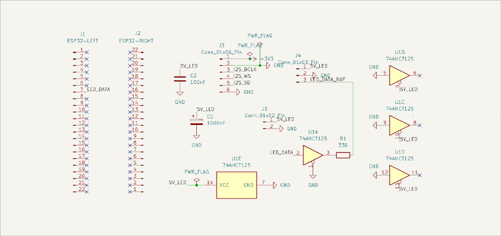
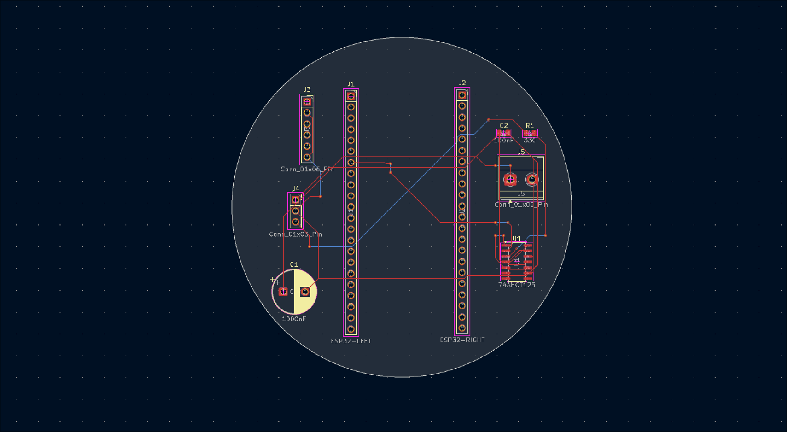
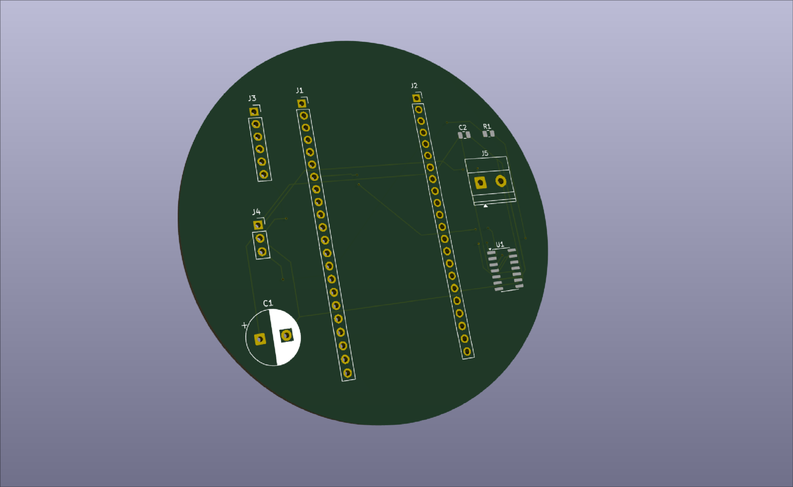

# pixelixx

pixelixx is an audio/noise-reactive 16x16 rgb led dot matrix visualizer. it uses an esp32-s3 to process audio input and drive a 16x16 WS2812B RGB LED matrix, with 4 different visualization modes designed to represent the different aspect sounds as well as introduce uniqueness to the project. 

I've always been interested in music, and the first thing I thought of when thinking about a screen-centric project was whether i could create something like cava (the audio spectrum visualizer) using a pixelated screen (deliberately low-res). I built pixelixx to experiment with this idea, and also to create some cool peripherals for my desk. this project also gave me another oppurtunity (excuse) to learn more across several areas of engineering, such as circuit design, pcb layout, embedded programming, digital audio processing, and hardware integration. 

## features
 pixellix is designed around 4 visualization modes:
 - oscillator: animated wave patterns that respond to noise or audio
 - frequency spectrum: the most cava directly like one. frequency bars that represent different parts of the audio spectrum.
 - bubble: expanding/pulsating visual elements based on audio intensity.
 - colorfield: a continously changing field of color, with different frequency bands on different parts of the matrix.

 ## audio input
 pixelixx is designed around two audio sources:
 1. system audio: captures computer audio through a pipewire monitor and sends pcm data to the esp32-s3 over usb serial
 2. ambient noise: uses an inmp441 i2s microphone module to capture sound from the surrounding enviornment.

 the audio source can be selected independently of the visualization mode.

 ## components
 | component | purpose  |
 |---|---|
 |ESP32-S3-DevKitC-1-N16R8 | MCU |
 |16x16 WS2812B RGB LED Matrix | Visual output | 
 |INMP441 Mic module | audio input|
 |74AHCT125 | LED data level shifting |
 |KY-040 EC11 Rotary encoder  | Physical interface|
 |Push button | mode selection|
 |external 5v supply| led matrix power |

 ## firmware and software
 the firmware was developed using esp-idf.
 
 software responsibilities include: 
 - acquiring audio samples from source
 - calculating audio intensity and frequency
 - mapping audio data to visualization patterns
 - generating led patterns
 - handling user input and mode selection

 ## project status
 
 ### ver 1: initial hardware prototype/PoC
 the initial design focuses on proving the firmware is functional, and that the hardware all works as intended: the esp32-s3 interface, audio input, led data circuitry, power distribution, and user controls.

 firmware development and hardware testing will bring the visualization modes together into a working device. 

 ## future improvements
 - refine audio processing
 - improve frequency analysis
 - add more visualization modes
 - develop an enclosure
 - explore audio playback capabilities (ie. showing the visualizer while playing the audio)
 - wirelessly recieving audio input data from pipewire

 ## resources and acknowledgement
 built as an independent electronics and embedded systems project using kicad and esp-idf.
